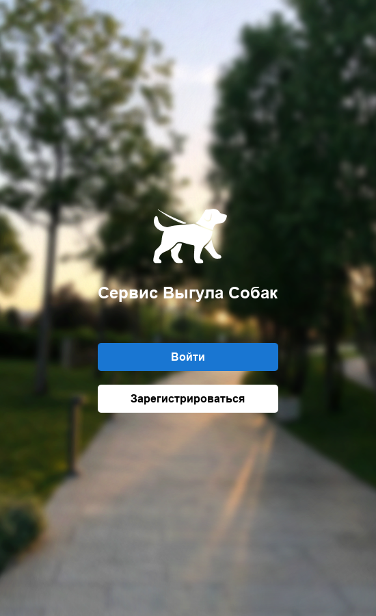

# Dog Walking Service

Учебный проект Арсения Батуева: настольный сервис выгула собак с клиентским интерфейсом на Python/PyQt6, PostgreSQL и необязательным кэшем Redis.

Владелец регистрирует питомца и создаёт заказ; исполнитель принимает его, начинает и завершает прогулку. Завершение формирует отчёт. Есть история заказов, статусы демонстрационной оплаты и отзывы. Реальные платежи приложение не проводит.

## Запуск

Нужны Python 3.10+ и PostgreSQL 15+. Redis ускоряет чтение справочников и ленты; при недоступном Redis запросы выполняются через PostgreSQL.

```powershell
python -m venv .venv
.venv/Scripts/python -m pip install -r requirements.txt
docker compose up -d
.venv/Scripts/python initialize_demo.py
.venv/Scripts/python run.py
```

В Linux вместо `.venv/Scripts/python` использовать `.venv/bin/python`. Docker применяется только для PostgreSQL/Redis, GUI запускается на компьютере пользователя. При собственной установке серверов задать параметры из `.env.example` в `.env` или переменных окружения. По умолчанию проект использует отдельные локальные порты 15432 и 16379.

Инициализация работает только с пустой базой и прекращается, если в ней уже есть таблицы. Демо-аккаунты: `owner@example.test` и `walker@example.test`, пароль обоих `dog_demo`. Эти значения относятся только к специально создаваемым примерам.



## Состав проекта

- `app/` - интерфейс и клиентские операции с данными.
- `bd/tables.sql`, `functions.sql`, `roles.sql` - схема, процедуры, триггер и учебный пример ролей СУБД.
- `settings.py` - единая конфигурация из окружения.
- `initialize_demo.py` - небольшое демонстрационное наполнение.
- `bd/` также содержит исходные учебные тесты и исследовательские скрипты. Для первого запуска использовать команды выше.

Клиентские роли определяют доступные экраны. Пример ролей PostgreSQL показан отдельно; GUI не выдаётся за готовую систему разграничения доступа для многопользовательского сервера. Хеширование паролей SHA-256 сохранено из учебной версии; проект предназначен для локальной демонстрации с тестовыми данными.

## Проверки

```powershell
.venv/Scripts/python -m pip install -r requirements-dev.txt
.venv/Scripts/python -m pytest tests -q
.venv/Scripts/python -m unittest discover -s bd -p test_app.py
```

Проверяются полный цикл заказа, запрет повторного принятия, чужой питомец и некорректный интервал времени. Интеграционные проверки требуют демонстрационную базу. Подготовка портфолио устранила фиксированные пути к изображениям и параметры личной базы; добавлены настройки, сценарий первого запуска и воспроизводимые проверки.
